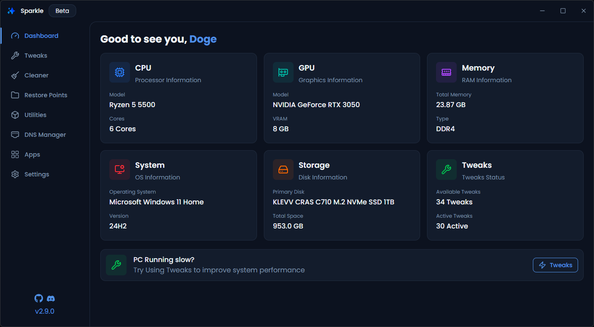

# Sparkle



Sparkle — настольное Windows-приложение для очистки, деблоата и базовой оптимизации системы. Проект объединяет набор твиков, обслуживание системы, управление DNS и запуск системных утилит в одном графическом интерфейсе.

## ✨ Особенности
- Применяет твики для деблоата и оптимизации Windows.
- Чистит временные файлы и запускает системные утилиты из GUI.
- Позволяет менять DNS-провайдера и работать с пакетными менеджерами.
- Поддерживает точки восстановления и базовый откат изменений.
- Собран как Electron-приложение с React-интерфейсом и PowerShell-автоматизацией.

## 🚀 Быстрый старт
### Требования
- Windows 10/11
- Node.js 22+
- `pnpm`

### Установка зависимостей
```bash
pnpm i
```

### Запуск в режиме разработки
```bash
pnpm dev
```

### Сборка
```bash
pnpm run build
```

### Установка через PowerShell-скрипт
```powershell
irm https://raw.githubusercontent.com/Parcoil/Sparkle/v2/get.ps1 | iex
```

## 📁 Структура проекта
- `src` — исходный код приложения, интерфейса и основной Electron-логики.
- `tweaks` — набор PowerShell-твиков и сценариев для оптимизации Windows.
- `resources` — иконки, логотипы и служебные ресурсы приложения.
- `images` — скриншоты и визуальные материалы README.
- `build.js` — скрипт сборки и упаковки приложения.

## 🛠 Использование
### Типовой сценарий
Запустите приложение, выберите категорию твиков или утилит, затем примените нужные действия из графического интерфейса.

### Что умеет интерфейс
Внутри приложения доступны деблоат, чистка, установка программ через Winget/Chocolatey, переключение DNS и просмотр базовой системной информации.

## 🧪 Технологии
- Electron
- React
- TypeScript
- PowerShell
- Node.js

Подпись относится к текущей версии проекта.

---

Автор: legenda  
Telegram: [@LEGENDA_SD](https://t.me/LEGENDA_SD)
